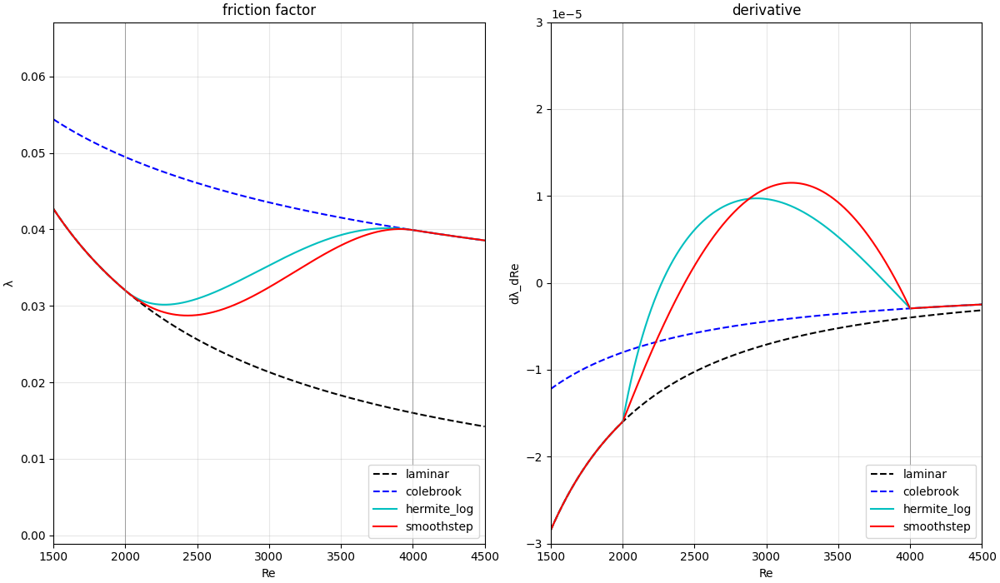

.. currentmodule:: pandapipes.pf.friction_factor_model

.. _friction_factor_models:

**********************
Friction Factor Models
**********************

.. automodule:: pandapipes.pf.friction_factor_model
   :no-members:
   :no-inherited-members:

.. autoclass:: FrictionFactorModel
    :members:

.. _individual_friction_factor_models:

Individual Friction Factor Models
=================================

.. autoclass:: Laminar
    :members:

.. autoclass:: Nikuradse
    :members:

.. autoclass:: SwameeJain
    :members:

.. autoclass:: Colebrook
    :members:

.. _regime_aware_friction_factor_model:

Regime-Aware Friction Factor Model
==================================

.. autoclass:: RegimeAwareFrictionModel
    :members:

.. autoclass:: TransitionStrategy
    :special-members: __call__

.. _transition_strategies:

Transition Strategies
---------------------

Both built-in strategies are :math:`C^1` at the regime boundaries and differ only
in the shape of the interior transition.

.. autofunction:: hermite_log

.. autofunction:: smoothstep

.. rubric:: Transition Shape

The figure shows :math:`\lambda` (left) and :math:`d\lambda / dRe` (right)
as functions of :math:`Re` for the full-regime function built with both strategies.

    :math:`\lambda` (left) and :math:`d\lambda / dRe` (right) across the regime boundaries.

Note that :math:`d\lambda / dRe` is positive inside the
transition: :math:`\lambda` rises from its laminar to its turbulent
value as the blend weight shifts, even though each endpoint model
individually decreases with :math:`Re`.

:func:`Hermite_log<hermite_log>` approaches the turbulent asymptote more aggressively
while keeping a moderate derivative peak. In the
:math:`(\ln Re, \ln(\lambda Re^2))` coordinates both asymptotes are
straight lines, so the interpolant bends smoothly from one to the other.
:func:`Smoothstep<smoothstep>` has a derivative that peaks sharply towards
the turbulent side of the transition.

.. tip::
    See the plot with 3 relative roughnesses (0, 0.0025 and 0.025, from top to bottom)
    to see how the shapes scale: :download:`hermite_vs_smoothstep_roughness_comparison.png`

.. rubric:: Choosing a Strategy

:func:`Smoothstep<smoothstep>` is cheaper per call -- the blend weight is a
polynomial in :math:`t`, with no :math:`\log` or :math:`\exp` -- and is
provided as a lower-cost alternative for callers whose convergence is
insensitive to the transition shape.

Neither shape has been shown to improve convergence in the pipeflow
solver: on pandapipes test networks, both strategies produced identical
iteration counts. The choice is a matter of preferred transition shape
rather than demonstrated robustness.
